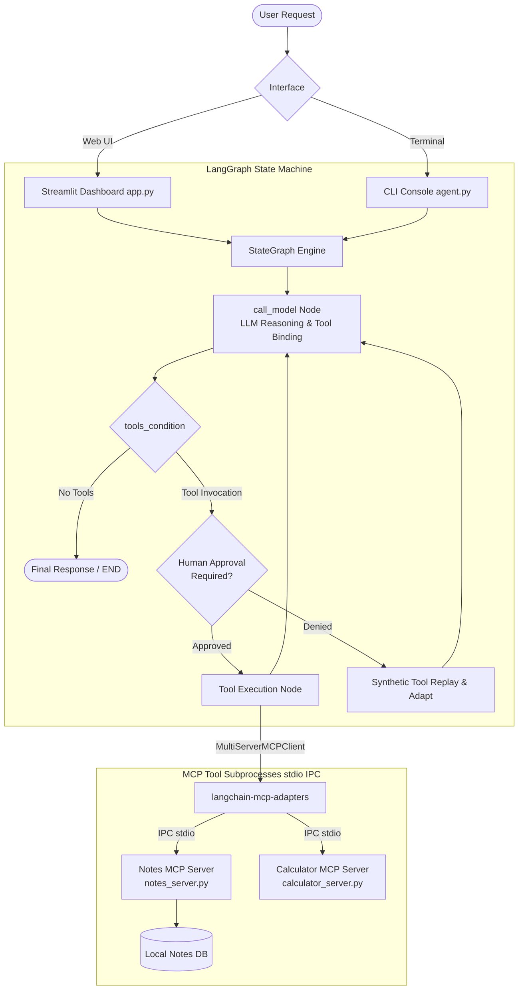

<div align="center">

# ⚡ NexusAgent MCP

### *Enterprise-Grade Agentic Orchestration Engine with LangGraph & Model Context Protocol*

[](https://www.python.org/)
[](https://langchain-ai.github.io/langgraph/)
[](https://modelcontextprotocol.io/)
[](https://streamlit.io/)
[](LICENSE)
[](https://github.com/anuraggurjar01)
[](https://www.linkedin.com/in/anuraggurjar1/)

<p align="center">
  <b>A modular, production-ready ReAct agent architecture featuring decoupled Model Context Protocol (MCP) server clusters, LangGraph state-machine orchestration, Human-in-the-Loop governance, and an interactive Streamlit telemetry dashboard.</b>
</p>

[Quickstart](#-quickstart-guide) • [Architecture](#-system-architecture) • [Features](#-core-capabilities) • [MCP Tools](#-mcp-tool-inventory) • [HITL Governance](#-human-in-the-loop-hitl-governance) • [Author & Connect](#-author--connect)

</div>

---

## 🌟 Highlights

- **Decoupled Tool Architecture:** Eliminates brittle function-calling code by leveraging Anthropic's **Model Context Protocol (MCP)** specification over isolated `stdio` inter-process communication.
- **LangGraph State Graph:** Cyclical ReAct (Reason + Act) loop tracking message state snapshots with non-destructive state progression.
- **Human-in-the-Loop (HITL) Checkpoints:** Inspect and approve or veto autonomous tool executions before runtime side-effects occur.
- **Dual Runtime Interfaces:** Choose between a full-featured **Streamlit Web Dashboard** with real-time tool inspection or a high-performance **Interactive CLI Console**.
- **Bi-Directional Knowledge Tools:** Read, search, create, and append markdown knowledge files with path traversal security boundaries.
- **Zero-Hallucination Math:** Deterministic numeric calculation and multi-metric statistical aggregation offloaded to Python mathematical engines.

---

## 📐 System Architecture



---

## 📁 Repository Structure

```
nexusagent-mcp/
├── app.py                      # Interactive Streamlit Web Dashboard & Telemetry UI
├── agent.py                    # LangGraph State Machine Core & Interactive CLI
├── run.bat                     # Windows Launch Selector (Web UI or CLI)
├── run_web.bat                 # Direct Streamlit Web Dashboard Launcher
├── run_cli.bat                 # Direct CLI Console Launcher
├── requirements.txt            # Production Python Dependencies
├── .env.example                # Environment Configuration Template
├── LICENSE                     # MIT Open-Source License (Anurag Gurjar 2026)
├── README.md                   # Comprehensive Architectural Documentation
├── INTERVIEW_CHEATSHEET.md     # Technical Interview Guide & STAR Resume Bullets
│
├── mcp_servers/                # Model Context Protocol Subprocess Clusters
│   ├── notes_server.py         # FastMCP Server: Knowledge Base & Note Management
│   └── calculator_server.py    # FastMCP Server: Deterministic Math & Statistics
│
└── notes/                      # Grounded Markdown Knowledge Base
    ├── meeting_notes.md        # Q1/Q2 Roadmap, Budgets, and Strategic Initiatives
    ├── project_ideas.md        # Engineering Backlog & System Architecture Proposals
    └── todo.md                 # Weekly Sprint Action Items & Milestones
```

---

## 🛠️ Core Capabilities

### 1. Model Context Protocol (MCP) Integration
Traditional tool integrations lock functions directly inside the agent repo. NexusAgent utilizes **FastMCP** servers running as independent child processes:
- **Isolation:** Tool crashes or heavy I/O cannot corrupt the core orchestrator's state.
- **Portability:** Any MCP-compliant client (Claude Desktop, Cursor, Custom Agents) can attach to `notes_server.py` or `calculator_server.py` without code changes.
- **Dynamic Tool Discovery:** Tools are discovered at runtime using `client.get_tools()`, translating schema descriptions directly into OpenAI function specifications.

### 2. LangGraph ReAct State Loop
The agent is orchestrated as a directed cyclic graph (`StateGraph`):
```
START ───► call_model ───► tools_condition ───► tools ───► call_model ───► END
```
- Preserves full state fidelity via `MessagesState`.
- Implements `MemorySaver` thread checkpointing (`thread_id`) enabling multi-turn memory without state collision.

### 3. Human-in-the-Loop (HITL) Safety Engine
Before executing any tool that could alter files or execute sensitive actions, the graph pauses at `interrupt_before=["tools"]`.
- Prompts the operator with exact tool names and input parameters.
- If **Approved (`y`)**: Resumes execution cleanly via checkpoint replay.
- If **Denied (`n`)**: Injects compliant synthetic `ToolMessage` payloads and adapts the response gracefully without unhandled crashes.

---

## 🔌 MCP Tool Inventory

### 📝 Notes Server (`notes_server.py`)
| Tool | Arguments | Description | Security Feature |
| :--- | :--- | :--- | :--- |
| `list_notes` | None | Lists all `.md` files with sizes and modification times | Directory confinement |
| `read_note` | `filename: str` | Retrieves full text of targeted markdown note | Path traversal check (`..` blocked) |
| `search_notes` | `query: str` | High-speed keyword search across all notes with line matching | Case-insensitive regex guard |
| `create_note` | `filename: str, content: str` | Creates a new markdown document | Strict `.md` extension enforcement |
| `append_to_note` | `filename: str, text: str` | Appends new entries or meeting minutes to existing note | Atomic file append |

### 🧮 Calculator Server (`calculator_server.py`)
| Tool | Arguments | Description | Guardrail |
| :--- | :--- | :--- | :--- |
| `add` | `a: float, b: float` | Computes arithmetic sum of two values | IEEE 754 float precision |
| `multiply` | `a: float, b: float` | Computes arithmetic product of two values | Overflow protection |
| `divide` | `a: float, b: float` | Performs floating point division | Zero-division exception handling |
| `percentage` | `value: float, percent: float` | Computes exact percentage fraction of base value | Accurate financial scaling |
| `summarize_numbers`| `numbers: list[float]` | Computes count, sum, mean, min, max, and std deviation | Empty-list input validation |

---

## 🚀 Quickstart Guide

### Prerequisites
- **Python 3.11+** installed
- **OpenAI API Key** ([Get an API key here](https://platform.openai.com/api-keys))

### Step 1: Clone Repository
```bash
git clone https://github.com/anuraggurjar01/nexusagent-mcp.git
cd nexusagent-mcp
```

### Step 2: Install Dependencies
```bash
pip install -r requirements.txt
```

### Step 3: Configure Environment Variables
Copy the example environment file and add your OpenAI key:
```bash
# Windows
copy .env.example .env

# macOS / Linux
cp .env.example .env
```
Edit `.env`:
```ini
OPENAI_API_KEY=sk-your-actual-api-key-here
LLM_MODEL=gpt-4o-mini
LLM_TEMPERATURE=0.7
```

### Step 4: Launch NexusAgent

#### Option A: Interactive Web Dashboard (Recommended)
```bash
streamlit run app.py
```
*Or double-click `run_web.bat` on Windows.*

#### Option B: Terminal CLI with Human-in-the-Loop
```bash
python -X utf8 agent.py
```
*Or double-click `run_cli.bat` on Windows.*

#### Option C: Single Headless Query
```bash
python -X utf8 agent.py --query "Read meeting notes and calculate 15% of the $250K budget"
```

---

## 💬 Sample Prompts & Agent Interactions

### Multi-Tool Chaining (Note Retrieval + Calculation)
```
User: "Read the meeting notes and calculate 15% of the $250K cloud budget."

NexusAgent Orchestration:
  1. [call_model] -> Invokes read_note(filename="meeting_notes.md")
  2. [Notes Server] -> Extracts budget line: "$250K allocated for cloud infrastructure upgrades"
  3. [call_model] -> Invokes percentage(value=250000, percent=15)
  4. [Calculator Server] -> Computes and returns 37500.0
  5. [call_model] -> Synthesizes final response:
     "Based on the meeting notes, 15% of the $250,000 cloud infrastructure budget is $37,500."
```

### Human-in-the-Loop (HITL) Interruption
```
User: "Create a note called release_v2.md with the deployment checklist"

--------------------------------------------------
  [Human Review] Agent wants to call:
    - create_note(filename='release_v2.md', content='...')
--------------------------------------------------
  Approve? (y/n): y

NexusAgent: Successfully created note 'release_v2.md'.
  Approved Tools: create_note
```

---

## 👨‍💻 Author & Connect

**Anurag Gurjar**  
*AI & Agentic Systems Developer*

- **GitHub:** [@anuraggurjar01](https://github.com/anuraggurjar01)
- **LinkedIn:** [linkedin.com/in/anuraggurjar1/](https://www.linkedin.com/in/anuraggurjar1/)
- **Portfolio Repository:** [NexusAgent MCP](https://github.com/anuraggurjar01/nexusagent-mcp)

---

## 📄 License

Distributed under the **MIT License**. See [`LICENSE`](LICENSE) for complete terms.  
Copyright © 2026 **Anurag Gurjar**.
